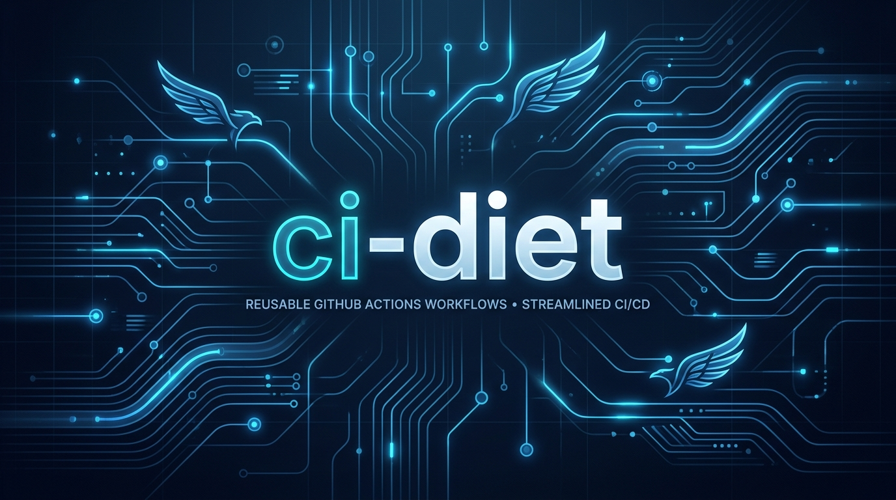
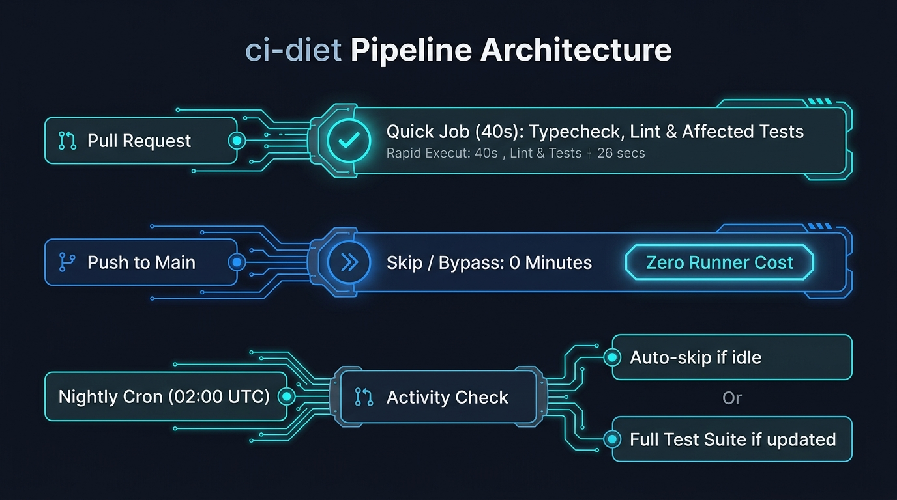
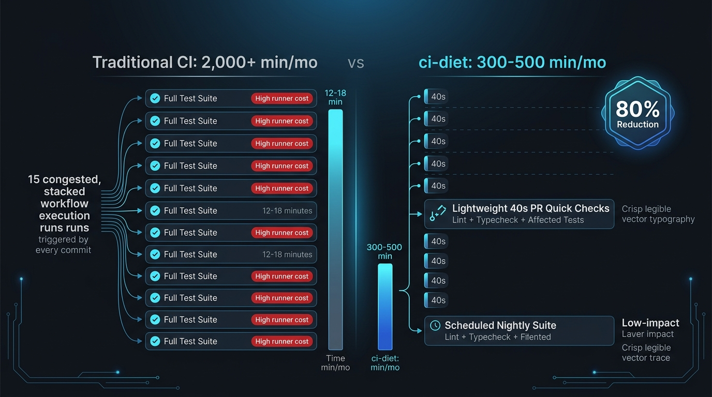
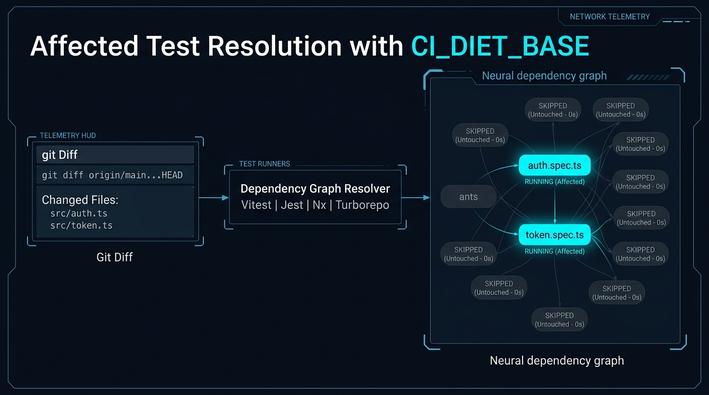

<p align="center">
  
</p>

# ci-diet

A reusable GitHub Actions workflow that cuts CI minutes for repos where coding
agents (or busy humans) push all day.

Running the whole test suite on every PR, and then again when it merges, gets
expensive once agents open dozens of PRs a day and the suite keeps growing.
ci-diet keeps a cheap check on every PR and moves the expensive suite to the
times it matters.

| When | Job | What runs |
|---|---|---|
| Every pull request | `quick` | your fast command: typecheck, lint, **only the tests affected by the diff** |
| PR from a release branch (`release/*`) | `full` too | the whole suite and build |
| Nightly (schedule) | `full` | the whole suite, **skipped if nothing was committed that day** |
| Manual (`workflow_dispatch`) | `full` | the whole suite, on any branch |
| Push to main | nothing | every change already ran `quick` on its PR; the nightly covers the rest |

<p align="center">
  
</p>

## Real numbers

On one private Electron/React repo (3.3k tests, 7–8.5 min suite, agents
merging ~10 PRs a day), the old setup ran the full suite on `pull_request`
**and** `push: main`: about **2,000 runner-minutes a month**.

With ci-diet, the PR check (typecheck + affected tests) takes about 40 s. The
projected total is **300–500 minutes a month**: the nightly full run costs at
most ~250, and PR checks cost the rest.

<p align="center">
  
</p>

## Quick start

Add `.github/workflows/ci.yml` to your repo:

```yaml
name: ci

on:
  pull_request:
  schedule:
    - cron: '17 9 * * *'   # nightly full suite
  workflow_dispatch:       # gh workflow run ci -r <branch>

concurrency:
  group: ci-${{ github.ref }}
  cancel-in-progress: true

permissions:
  contents: read

jobs:
  ci:
    uses: DevvGwardo/ci-diet/.github/workflows/ci-diet.yml@v1
    with:
      node-version: '22'
      setup-command: npm ci
      quick-command: |
        npx tsc --noEmit
        npx vitest run --changed "$CI_DIET_BASE"
      full-command: |
        npx vitest run
        npm run build
```

The `quick` job exports `CI_DIET_BASE` (for example `origin/main`) with full
git history, so your test runner can pick only the tests the PR touches.

### Affected-test recipes

<p align="center">
  
</p>

| Runner | `quick-command` |
|---|---|
| Vitest | `npx vitest run --changed "$CI_DIET_BASE"` |
| Jest | `npx jest --changedSince="$CI_DIET_BASE"` |
| Nx | `npx nx affected -t test --base="$CI_DIET_BASE"` |
| Turborepo | `npx turbo run test --filter="...[$CI_DIET_BASE]"` |
| Anything else | a typecheck or lint plus your fastest smoke tests |

Vitest and Jest still run everything when config or `package.json` changes.

## Inputs

| Input | Default | Meaning |
|---|---|---|
| `quick-command` | required | Runs on every PR. |
| `full-command` | required | Runs nightly, on release PRs and on manual runs. |
| `setup-command` | `''` | Runs before either command, e.g. `npm ci`. |
| `node-version` | `''` | If set, runs `actions/setup-node` with npm caching. |
| `release-branch-prefix` | `release/` | PRs from branches with this prefix also run `full`. Empty disables it. |
| `nightly-window-hours` | `25` | A scheduled run skips if the newest commit is older than this. `0` always runs. |
| `runs-on` | `ubuntu-latest` | Runner for both jobs. |
| `quick-timeout-minutes` | `10` | |
| `full-timeout-minutes` | `30` | |

Commands run with `bash -eo pipefail`, so a multi-line command stops at the
first failure. If they need secrets, add `secrets: inherit` under `uses:`.

## Tradeoffs

- A regression in a test the affected-test selection misses can land on
  `main`. The nightly run catches it within a day, and GitHub emails the repo
  owner when a scheduled run fails.
- If you need `main` to be green after every merge (continuous deployment
  straight from `main`), keep a full run on `push: main` and use ci-diet only
  to slim down the PR checks.
- Public repositories already get Actions minutes for free. ci-diet matters
  most for private repositories.

## License

MIT
